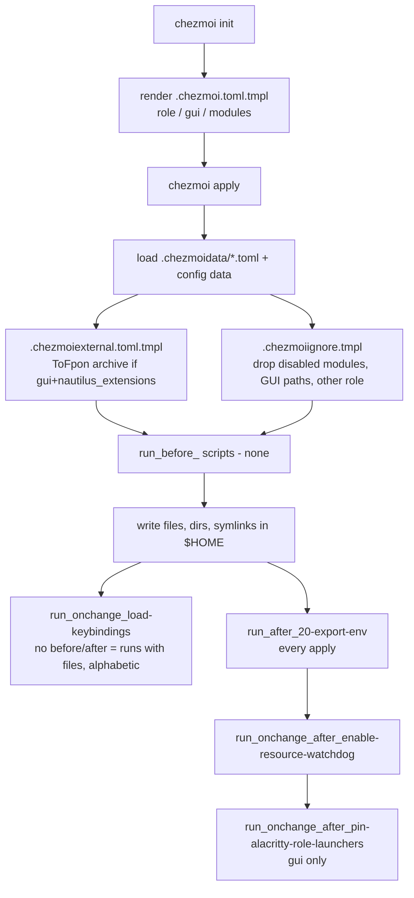

# Bootstrap

How a machine goes from nothing to a working shell with these dotfiles. Everything
here was checked against the code in this repo (chezmoi v2.71). Items marked
**(unverified)** are inferred, not shown by the code.

## 1. Prerequisites

| Need | Why | Where it comes from |
|------|-----|---------------------|
| `git`, `curl` | Clone the repo, fetch the chezmoi installer | OS packages |
| `chezmoi` | Applies `home/` to `$HOME` | Official script, or the provisioner (below) |
| `bash` (and optionally `zsh`) | Both rc files are rendered | OS |
| `mise` | Tools from `~/.config/mise/conf.d/dotfiles.toml`, tasks | Not installed by this repo (Omakub base on the laptop) |
| `jq` | `modules:test` reads `chezmoi data` with it | mise / OS |
| `nvim` | `chezmoi merge` uses `nvim -d` | OS |
| GUI host only: `dconf`, `gsettings`, `systemctl --user` | run_ scripts | GNOME desktop |

The repo installs **no** packages. `install.sh` files inside modules are never run or
sourced by chezmoi.

### The workstation provisioner

The `python -m provisioner` referred to in older docs lives **outside this repo** at
`~/projects/post-provisi0on` (package `workstation_provisioner`, config
`~/.config/provisioner/config.toml`). Its subcommands are `ssh` (SSH + 1Password agent),
`tailscale` (install + join tailnet) and `tools` (Sublime, VS Code, Cursor via APT, and the
chezmoi binary into `~/.local/bin`; `--skip-chezmoi` etc.). It does **not** run
`chezmoi init`/`apply`. Its code currently has no handling for the Nautilus extension
manifest or module `install.sh` files, even though `nautilus-extensions.toml` comments say
"provisioner installs" — treat that as planned, not implemented.

## 2. Install chezmoi

```bash
sh -c "$(curl -fsLS https://get.chezmoi.io)" -- -b "$HOME/.local/bin"
# or, on the laptop: cd ~/projects/post-provisi0on && python -m provisioner tools
```

## 3. Init and apply

`.chezmoiroot` contains `home`, so chezmoi treats `home/` as the source state. Files
outside `home/` (README, `tests/`, `mise.toml`, `custom/`, …) never reach `$HOME`.

### Local laptop

On the laptop the checkout is `~/projects/dotfiles` and `~/.local/share/chezmoi` is a
symlink to it.

```bash
git clone <repo-url> ~/projects/dotfiles
ln -s ~/projects/dotfiles ~/.local/share/chezmoi     # or: chezmoi init --source ~/projects/dotfiles
chezmoi init            # renders ~/.config/chezmoi/chezmoi.toml from home/.chezmoi.toml.tmpl
chezmoi diff            # review
chezmoi apply
```

The hostname must be in `home/.chezmoidata/hosts.toml` as `role = "local"` (it is:
`god-Latitude-7390-2-in-1`), otherwise the laptop is treated as a headless server.

### Remote server

```bash
sh -c "$(curl -fsLS https://get.chezmoi.io)" -- -b "$HOME/.local/bin"
chezmoi init --apply <repo-url>
```

Known server hostnames: `ubuntu-server` and `Ubuntu-24` (the Coolify/Hetzner host, SSH
alias `ubuntu`). Any hostname not listed also becomes `role=remote, gui=false`.

### Preview as another host

```bash
DOTFILES_HOSTNAME=Ubuntu-24 chezmoi init --source ~/projects/dotfiles   # re-render config
chezmoi diff
```

`DOTFILES_HOSTNAME` is read by the config template only, so it takes effect at `chezmoi init`
(or `execute-template`), not on a plain `apply` with an existing config. **Re-run
`chezmoi init` afterwards without it** to restore the real host.

## 4. How role, gui and modules are decided

`home/.chezmoi.toml.tmpl` (rendered at `chezmoi init`, no interactive prompts):

1. `hostname = $DOTFILES_HOSTNAME`, else `.chezmoi.hostname`.
2. Reads `.chezmoidata/hosts.toml`: `role` defaults to `remote`; `gui` defaults to
   `true` only when `role == "local"`.
3. Reads `.chezmoidata/modules.toml`: a module is active when `enabled = true` and
   (`requires_gui` is false or the host has `gui = true`).
4. Writes `[data] role, gui, hostname, git_name, git_email, github_user` and
   `[data.modules]` (one bool per module) plus a `[merge]` section (`nvim -d`).

Because this is baked into `~/.config/chezmoi/chezmoi.toml`, **editing `modules.toml` or
`hosts.toml` needs `chezmoi init` before `chezmoi apply`** to take effect. (Example: today
`modules.toml` says `nautilus = false`, but the rendered config on the laptop still has
`nautilus = true` because init was not re-run.) chezmoi warns when the config template
changed, but not when only the included data files changed **(unverified; chezmoi hashes
the template text)**.

All other `.chezmoidata/*.toml` files (`paths`, `env`, `dependencies`, `tools`, `skills`,
`ide-extensions`, `nautilus-extensions`) are merged into template data automatically.

## 5. What `chezmoi apply` does, in order



1. **Data**: config `[data]` + `.chezmoidata/*.toml`.
2. **Externals** (`.chezmoiexternal.toml.tmpl`): only when `gui` and
   `modules.nautilus_extensions` are true, a SHA-256-pinned tarball of
   ToFpon/Nautilus-Extensions is unpacked into `~/.local/share/nautilus-python/extensions`
   (six files listed in `include`).
3. **Ignore rules** (`.chezmoiignore.tmpl`):
   - source metadata, `configs/`, `server_only/`, `**/.env`, `.config/secrets/`,
     `**/__pycache__`, `.config/mise/config.toml` (never managed);
   - per-module: `.gitconfig` (git), `.ssh/config` (ssh), `.config/mise/conf.d/` (mise),
     `.dotfiles/modules/<name>/` for docker, hashicorp-vault, openclaw, hermes, hermes-v2,
     coolify-manager, and `.dotfiles/common/` (common). **tailscale, extras and coolify
     have no ignore gate** — their folders are applied whenever they exist;
   - `gui = false`: every desktop path (Nautilus, Alacritty, ulauncher, environment.d,
     `.cursor/`, `.gemini/`, `.local/share/applications/*`, …); with `gui = true` the
     `gui`, `nautilus`, `nautilus_extensions`, `thunar` toggles still apply;
   - role: non-local hosts drop `.dotfiles/local/`, `.local/bin/openclaw-remote`,
     `.dotfiles/modules/hermes-v2/`; non-remote hosts drop `.dotfiles/remote/` and
     `.dotfiles/modules/local_to_remote`.
4. **Files**: everything else under `home/` is written (`dot_` → `.`, `private_` → 0600/0700,
   `executable_` → +x, `symlink_` → symlink, `.tmpl` rendered).
5. **Scripts** (`home/.chezmoiscripts/`, chezmoi runs `before` → files → `after`, each group
   alphabetically):
   | Script | When | What |
   |--------|------|------|
   | `run_onchange_load-keybindings.sh.tmpl` | when either dconf `.ini` hash changes | `dconf load` of `configs/dconf/media-keys.ini` and `wm-keybindings.ini`. **Not gated on gui.** |
   | `run_after_20-export-env.sh.tmpl` | every apply | writes `~/.config/environment.d/90-chezmoi.conf` from `env.toml` (currently empty) and pushes vars to `systemctl --user` / D-Bus |
   | `run_onchange_after_enable-resource-watchdog.sh.tmpl` | unit or script hash changes | `systemctl --user enable --now resource-watchdog.service`; skips without a user manager |
   | `run_onchange_after_pin-alacritty-role-launchers.sh.tmpl` | gui only, content change | adds remote/agent Alacritty launchers to the GNOME dock |

## 6. How the shell loads

`~/.bash_profile` just sources `~/.bashrc`. `~/.bashrc` and `~/.zshrc` do, in order:

1. `CHEZMOI_HOME` = `realpath $(chezmoi source-path)` (fallback
   `~/.local/share/chezmoi/home`); bash stops here for non-interactive shells.
2. `DF_DIR=~/.dotfiles`.
3. **source-common.tmpl**: first `common/helpers.sh` (`_df_source`, `_df_load_module`;
   applied even when `modules.common` is off, inline fallback if missing), then (if `modules.common`): `common/shell`, `aliases`, `functions`,
   `prompt`, `help`, `completions.bash`, `completions.zsh`, then every file in
   `common/utils/` (chezmoi helpers: `chezmoi_add_env`, `chezmoi_add_path`, …).
4. bash only: an `ssh()` wrapper that tints the terminal background.
5. **source-role.tmpl**: `~/.dotfiles/<role>/{env,aliases,functions,chezmoi-helpers.aliases,chezmoi-helpers.functions}`
   if present. `remote/remote_helpers.sh` is loaded by `modules/docker/config.toml` (`files`), not here.
   `remote/scripts/` holds remote-only scripts (role=remote only; name executables `executable_*`).
6. **source-modules.tmpl**: for each active module except
   `common git ssh gui nautilus nautilus_extensions thunar mise`, call
   `_df_load_module ~/.dotfiles/modules/<name>`, which follows `config.toml` `[bootstrap]`
   (see "Module config.toml" below). `local_to_remote` and `hermes-v2` load only on `role = local`.
   `install.sh`, READMEs and `*.env.example` are never sourced.
7. bash only: `~/.bash_aliases`.
8. PATH from `paths.toml` (`prepend`, then `common` + role list appended), then
   `common/init` (`mise activate`, zoxide, fzf, starship).
9. `~/.bashrc.local` / `~/.zshrc.local` (untracked overrides).
10. bash only: `source ~/.env` (unconditional — see troubleshooting), then
    `~/.config/alacritty/terminal-roles.sh`, then the APM block.

## 7. mise integration

- `~/.config/mise/config.toml` is never touched (ignored).
- With `modules.mise`, chezmoi writes **`~/.config/mise/conf.d/dotfiles.toml`**: baseline
  tools (ripgrep, fzf, fd, bat, eza, zoxide), plus lazygit/lazydocker/starship on
  `role=local`, plus vault/jq when `hashicorp-vault` is on; `[env]` loads
  `~/.config/secrets/.env` with `redact = true` and sets a couple of plain variables.
  The tool list is hard-coded in the template; `dependencies.toml` is documentation only
  (it is not read by the template).
- Task scripts are applied to `~/.config/mise/tasks/` (`chezmoi-audit`, `modules-test`,
  `editors/sync`). The task names are defined in the **repo-root `mise.toml`**, so run them
  from the checkout:
  ```bash
  cd ~/projects/dotfiles
  mise run chezmoi:audit              # read-only status + diff (-- --diff-only mentioned in usage)
  mise run modules:test               # bash: every enabled module's functions load
  mise run modules:test -- --zsh      # also zsh
  mise run modules:test -- -v         # list every function checked
  ```
- Repo-root `mise.toml` also loads the repo's `.env` (redacted) and sets `CHEZMOI_BASE`,
  `CHEZMOI_BASE_HOME`, `AIDER_MODEL`. `mise.local.toml` is gitignored; `mise.remote.toml`
  is empty.

## 8. Secrets

- Never committed: `.gitignore` covers `.env`, `*.env` (except `*.env.example`),
  `mise.local.toml`, `home/server_only/*` dumps; `.chezmoiignore.tmpl` keeps
  `.config/secrets/` and `**/.env` out of chezmoi.
- Live secrets go in `~/.config/secrets/.env` by hand, using the key names in
  `home/dot_dotfiles/secrets.env.example`. They reach programs via mise `[env]` (redacted)
  and via `~/.config/environment.d/50-secrets.conf`, a symlink to that file (gui hosts).
- Module examples: `coolify.env.example`, `vault.env.example`, `hermes.env.example`,
  `hermes-gate.env.example`, `openclaw.env.example`.
- Do not `cat` these files in logs or docs; use `mise env --redacted` style tooling.

## 9. Verify

```bash
chezmoi data --format json | jq '{role,gui,hostname,modules}'
chezmoi status                      # empty = in sync
cd ~/projects/dotfiles && mise run modules:test -- --zsh
tests/check.sh                      # renders templates, syntax-checks scripts, parses data
exec bash -l; manual                # module-aware command index
manual module docker
```

## 10. Troubleshooting

| Symptom | Cause / fix |
|---------|-------------|
| Module toggle has no effect | Run `chezmoi init` (re-renders config), then `chezmoi apply`. |
| Laptop gets no GUI files | Hostname missing from `hosts.toml` → defaults to remote/no-gui. Check `chezmoi data`. |
| `mise run modules:test` → "no tasks defined" / "Permission denied" | Task files are not executable in `$HOME` (source files lack the `executable_` prefix) and the tasks are defined only in the repo `mise.toml`. Workaround: `cd ~/projects/dotfiles && bash ~/.config/mise/tasks/modules/test`. |
| `bash: /home/…/.env: No such file` on new shells | `.bashrc` does `source "${HOME}/.env"` without an existence check. Create the file or add a guard. |
| `dconf: command not found` on a server apply | `run_onchange_load-keybindings` is not gated on gui. |
| `modules:test` "warn extras" | `extras/` has only `scan-yaml.sh`, which the loader never sources (it is a script, not a module). |
| Wrong preview after `DOTFILES_HOSTNAME=…` | That host's data is now in your config — re-run `chezmoi init` without the variable. |
| Externals fail checksum | Upstream archive changed; follow the comment in `.chezmoiexternal.toml.tmpl`. |


## Module config.toml

```toml
# ~/.dotfiles/modules/<name>/config.toml
[bootstrap]
env         = ["${XDG_CONFIG_HOME:-$HOME/.config}/<name>/environment"]  # sourced with set -a (exported)
files       = ["functions.sh"]       # always, in order
interactive = ["aliases.sh"]         # interactive shells only
bash        = ["completions.bash"]   # interactive bash only
zsh         = ["completions.zsh"]    # interactive zsh only
```

Load order is fixed: `env` → `files` → `interactive` → `bash`|`zsh`, each list in order. All keys
are optional; arrays may be single- or multi-line, with `#` comments and `"…"`/`'…'` strings (no
escapes). Relative paths resolve against the module dir; `~` and `$VAR`/`${VAR:-default}` are
expanded (`$(` and backticks are refused). Missing files are skipped. Every file goes through
`_df_source`, so `DEBUG_MODE=1 bash -i` lists each one. Parsed by a single `awk` call in
`common/helpers.sh` (no python/yq at shell startup). No `config.toml` → legacy fallback:
`module.sh`, else `functions.sh`, `aliases.sh`, `functions`, `local_to_remote.sh`.
`module.sh` is now **metadata only** (`## @module/@title/@source …` for `manual`); it is not sourced
when `config.toml` exists.
